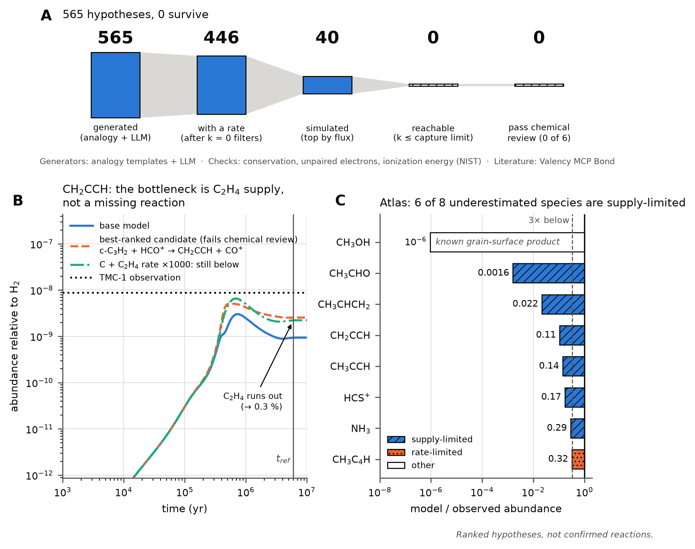

# TAPIR — Tracking Absent Pathways in Interstellar Reactions

TAPIR proposes reactions that may be missing from the KIDA astrochemistry network, simulates each one in
a dark-cloud model and ranks them by how well they explain the abundances observed in TMC-1.

[](LICENSE)
[](pyproject.toml)
<!-- TODO: add the molab badge once the app is published:
[](MOLAB_URL) -->

> **Ranked hypotheses, not confirmed reactions.**



**Figure.** (A) From 565 candidate reactions to none that survives.
(B) CH₂CCH: the bottleneck is C₂H₄ supply, not a missing reaction.
(C) Atlas: model/observed abundance for the 8 species under-predicted by more than 3x, by diagnosis.

## At a glance

- **Validation.** TAPIR rediscovers hidden KIDA reactions: first place in 5 of 6 cases, MRR 0.875
  against 0.445 for a random order of the same candidates.
- **Analogy vs. LLM.** The analogy generator recovers 6 of 6 hidden reactions, the LLM 2 of 6.
- **CH₂CCH.** None of the 40 simulated candidates is reachable at a physical rate. The main route,
  C + C₂H₄, is limited by the supply of C₂H₄, and this holds in a second model configuration.
- **Atlas.** 6 of the 8 TMC-1 species the model underestimates more than 3× are limited by the supply
  of a precursor.
- **Chemical checks.** A manual review rejects all 11 top candidates; the ionization-energy flag
  agrees with the review in 8 of 8 cases.

## The problem

Telescopes observing the cold cloud TMC-1 find molecules in amounts that chemical models cannot
reproduce. The model may miss a reaction, use a wrong rate, or lack physics it does not include.
Checking every possible missing reaction by hand is not feasible. TAPIR automates the search and
reports what it cannot explain.

## How it works

1. **Generate.** Two generators propose reactions that form the target molecule. The analogy
   generator learns reaction templates from KIDA. The LLM generator proposes reactions with a one-line
   rationale. Both go through the same steps below.
2. **Filter.** Atoms and charge must be conserved, all species must already exist in the network and
   the reaction must be new. Three flags mark suspicious chemistry: more unpaired electrons in the
   products, an H atom moving where a proton should, and the charge ending on the product with the
   higher ionization energy (93 values from the NIST WebBook). Each flag was validated on KIDA first.
   Only the unpaired-electron flag excludes candidates; the others only mark them.
3. **Simulate.** Each candidate is added alone to a 0D gas-phase dark-cloud model (KIDA 2024,
   T = 10 K) with an estimated rate: a KIDA class median or a generic capture rate. Candidates are
   scored against the TMC-1 abundances.
4. **Required rate.** For each candidate, TAPIR finds the rate it would need to reach the observed
   abundance and compares it with the capture limit, the fastest rate physically possible for its class.
5. **Literature.** Valency MCP Bond searches the literature for the top hypotheses. An LLM only
   classifies what Bond returns (measured, proposed, computed or no evidence found). References that
   do not appear in Bond's text are dropped.

The Marimo app (`app/tapir_app.py`) shows the validation cases, the CH₂CCH hypotheses, their chemical
review and robustness check, the TMC-1 discrepancy atlas, and the analogy-vs-LLM comparison. It reads
precomputed data only and needs neither the networks nor the `tapir` package.

## Results

### Validation: knock-out benchmark

We remove a reaction the network needs and check whether TAPIR ranks it first without having seen it.

| Case | Hidden reaction | Final rank |
|---|---|---|
| CH₂CHCN | CN + C₂H₄ → H + CH₂CHCN | 1 |
| CH₃CN | CH₃CNH⁺ + e⁻ → H + CH₃CN | 1 |
| HNCCC | HC₃NH⁺ + e⁻ → H + HNCCC | 4 |
| HCCCHO | O + CH₂CCH → HCCCHO + H | 1 |
| H₂CS | S + CH₃ → H + H₂CS | 1 |
| N₂H⁺ | N₂ + H₃⁺ → H₂ + N₂H⁺ | 1 |

| Metric | TAPIR | Random order |
|---|---|---|
| Ranked first (Hits@1) | 5/6 | – |
| In the top 5 (Hits@5) | 6/6 | – |
| Mean reciprocal rank (MRR) | 0.875 | 0.445 |

<sub>Source: `results/benchmark_b.csv`; random baseline over the same candidates:
`results/bench_llm_summary.json`.</sub>

The one miss, HNCCC, loses to the same chemistry with the wrong isomer (CN + C₂H₂ → HNCCC + H).

### Analogy vs. LLM

Same 6 cases, same filters, rates and simulation for every generator.

| Generator | Recovered | Ranked first | MRR |
|---|---|---|---|
| Analogy | 6/6 | 5/6 | 0.875 |
| LLM | 2/6 | 1/6 | 0.250 |
| Union | 6/6 | 4/6 | 0.792 |

<sub>Source: `results/bench_llm_summary.json`.</sub>

In the union, an LLM candidate pushes CH₃CN to second place. The hidden reactions are public KIDA
reactions that the LLM may have seen in training, so its score is an upper bound.

### CH₂CCH (propargyl)

| Step | Result |
|---|---|
| Model / observed abundance | 0.107 (9× too low) |
| Candidates generated (analogy + LLM) | 565 |
| Candidates simulated | 40 |
| Reachable below the capture limit | 0 |
| Chemical review (6 for CH₂CCH, 5 for its precursors) | 11 of 11 implausible |
| Literature check, top 10 | 9 no evidence found, 1 computed (with a barrier) |

<sub>Source: `results/discovery/CH2CCH.json`, `results/discovery/chem_review.json`.</sub>

**Diagnosis.** We make the main formation reaction, C + C₂H₄, 1000× faster. CH₂CCH barely rises
because C₂H₄ runs out. The same holds in a second configuration (higher sulphur, younger cloud):

| | Reference configuration | Second configuration |
|---|---|---|
| Model / observed abundance | 0.107 (9× low) | 0.065 (15× low) |
| Share of CH₂CCH formed by C + C₂H₄ | 60 % | 99 % |
| CH₂CCH with C + C₂H₄ × 1000 | 2.4× higher | 4 % higher |
| C₂H₄ left with C + C₂H₄ × 1000 | 0.3 % | 0.1 % |
| Reachable candidates | 0 | 0 |

<sub>Source: `results/discovery/CH2CCH.json` (`existing`, `bottleneck`, `config2`,
`bottleneck_config2`). Reference: C/O = 1.2, S = 8×10⁻⁸, t = 6×10⁶ yr; second: C/O = 1.2,
S = 1.5×10⁻⁵, t = 4.5×10⁵ yr.</sub>

Missing grain chemistry is the leading explanation. It is a hypothesis, not tested here.

### Atlas of TMC-1

The same pipeline over every observed species the model underestimates more than 3× (8 species,
analogy generator only, ~3.5 min). No species has a reachable, unflagged candidate. Diagnosis after
making the main formation reaction 1000× faster:

| Species | Model / observed | Diagnosis | Main formation route | Runs short of |
|---|---|---|---|---|
| CH₃OH | 10⁻⁶ | other | CH₃ + OH⁻ → CH₃OH + e⁻ | – |
| CH₃CHO | 0.0016 | supply-limited | CH₃CHOH⁺ + e⁻ | CH₃CHOH⁺ |
| CH₃CHCH₂ | 0.022 | supply-limited | H + C₃H₅ → CH₃CHCH₂ + hν | C₃H₅ |
| CH₂CCH | 0.107 | supply-limited | C + C₂H₄ | C₂H₄ |
| CH₃CCH | 0.14 | supply-limited | H + CH₂CCH → CH₃CCH + hν | CH₂CCH |
| HCS⁺ | 0.17 | supply-limited | CS + HCO⁺ | CS |
| NH₃ | 0.29 | supply-limited | NH₄⁺ + e⁻ | NH₄⁺ |
| CH₃C₄H | 0.32 | rate-limited | C₅H₅⁺ + e⁻ | – |

<sub>Source: `results/discovery/atlas.json`.</sub>

*Supply-limited*: a reactant falls below 10 % of its value and the target still falls short.
*Rate-limited*: the faster reaction alone closes the gap. *Other*: neither. Methanol, short by a factor
of a million, is "other"; it is known to form on grains.

### Chemical checks

| Check | Result |
|---|---|
| Manual chemical review of the top candidates | 11 of 11 implausible |
| Ionization-energy flag vs. the review | agrees in 8 of 8 charge-related cases |
| Ionization energies used | 93 values, NIST WebBook |

<sub>Source: `results/discovery/chem_review.json`, `data/ionization_energies.csv`.</sub>

## Quickstart

Install (Python 3.10 or later):

```bash
git clone https://github.com/javisros/tapir.git
cd tapir
python -m venv .venv
source .venv/bin/activate
pip install -r requirements.txt marimo
```

Configure the LLM and Bond credentials. They are only needed for the LLM generator and the literature
check; everything else runs without them.

```bash
cp .env.example .env
```

Run the tests (~1.5 min):

```bash
python -m pytest
```

Reproduce the knock-out benchmark (~75 s on 4 processes):

```bash
python -m scripts.benchmark_b
```

Run discovery for CH₂CCH (~2 min), the second configuration (~30 s) and the literature check
(needs `.env`):

```bash
python -m scripts.discover CH2CCH
python -m scripts.robustness results/discovery/CH2CCH.json
python -m scripts.check_literature results/discovery/CH2CCH.json
```

`discover` uses the analogy generator by default (558 candidates for CH₂CCH). Add
`--generators analogy,llm` to include the LLM generator, as in the stored results (565 candidates;
needs `.env`).

Build the atlas of underestimated TMC-1 species (~3.5 min):

```bash
python -m scripts.atlas
```

Refresh the app data and open the app:

```bash
python -m scripts.export_app_data
marimo run app/tapir_app.py
```

Scripts overwrite their files in `results/`. Set `TAPIR_RESULTS=/some/dir` to write elsewhere. Each
script documents its options in its docstring.

## Repository structure

```
tapir/            library: 0D model, generators, rates and flags, discovery, literature check
scripts/          command-line entry points (python -m scripts.<name>)
tests/            test suite (pytest)
app/              Marimo app and its precomputed data (app/data/)
results/          outputs of the scripts; results/discovery/ for discovery mode
networks/         KIDA networks kida.uva.2014 and kida.uva.2024
data/             ionization energies from the NIST WebBook
benchmark/        the 6 knock-out cases
docs/             technical notes
```

Model, generator families, benchmarks and the validation of the base model against Wakelam et al.
(2024) are described in [docs/technical.md](docs/technical.md).

## Limitations

- **Gas phase only.** No grain chemistry, the likely missing piece for several species.
- **Generic rates are optimistic upper bounds.** Capture rates ignore barriers; some radical reactions
  (e.g. CH₃ + C₂H₂) have one and are far slower at 10 K.
- **No isomers.** The generator works by elemental composition and cannot tell HNCCC from HC₃N.
- **No radiative association estimator**, so those candidates are not simulated.
- **Overestimated species** (e.g. C₅O, c-C₃H₂) need a destruction mode, which is not implemented.
- **"No evidence found" does not prove there is no literature.** It only means Bond returned nothing
  usable.
- **The ionization-energy filter only marks candidates.** It does not remove them.

## Built with

- **Valency MCP Bond**: literature search for the top hypotheses.
- **[Marimo](https://marimo.io)**: the interactive app.
- **[LiteLLM](https://github.com/BerriAI/litellm)**: OpenAI-compatible proxy for the LLM generator and
  the literature classifier.
- **[KIDA](https://kida.astrochem-tools.org)**: the kida.uva.2014 and kida.uva.2024 reaction networks.
- **[NIST Chemistry WebBook](https://webbook.nist.gov)**: ionization energies.
- NumPy, SciPy and Matplotlib.

## References

TAPIR uses the following data and publications:

- **KIDA.** Wakelam, V., et al. 2024, *The 2024 KIDA network for interstellar chemistry*, A&A, 689,
  A63, [doi:10.1051/0004-6361/202450606](https://doi.org/10.1051/0004-6361/202450606) (kida.uva.2024);
  Wakelam, V., et al. 2015, ApJS, 217, 20 (kida.uva.2014); rate formulas from Wakelam, V., et al. 2012,
  ApJS, 199, 21. See [networks/README.md](networks/README.md).
- **TMC-1 observations** (`tapir/observations.py`). Gratier, P., et al. 2016, ApJS, 225, 25;
  CH₂CCH from Agúndez, M., et al. 2021, A&A, 647, L10; other species from the QUIJOTE papers
  (Cernicharo et al. 2020, 2021) and Marcelino, N., et al. 2007, ApJ, 665, L127.
- **Ionization energies** (`data/ionization_energies.csv`). NIST Chemistry WebBook, NIST Standard
  Reference Database 69 (Linstrom, P. J. & Mallard, W. G., eds.), one source URL per value.

## License

Code under the MIT License ([LICENSE](LICENSE)). The KIDA network files keep their own terms of use.

